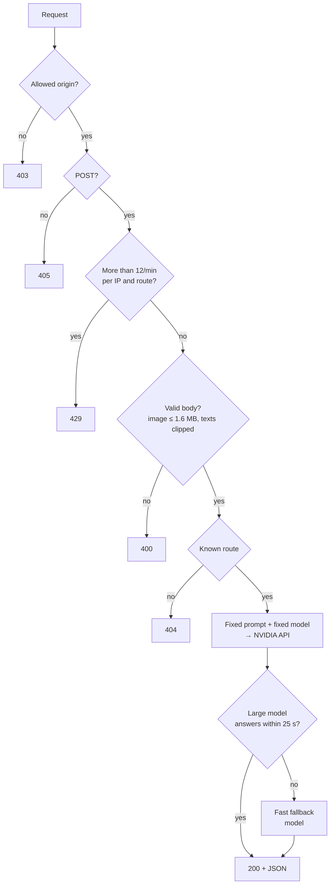

# nv-gateway

**A minimal gateway between static GitHub Pages sites and the NVIDIA API. The page never sees the key; the server only performs five fixed tasks.**


[Español](README.md) · **English**



## Why it exists

GitHub Pages only serves static files. Calling an NVIDIA model from a page needs an API key, and a key inside a public page's JavaScript is exposed. This Worker keeps it as a **Cloudflare secret** and exposes only what the pages need.

**It is not an open proxy.** Each route builds its own prompt and picks its model server-side; the browser only sends the photo or the question.

## Routes

| Route | Used by | Model | Input → output |
|---|---|---|---|
| `POST /inspect` | [Field Inspector](https://github.com/JSNN15/inspector) | Nemotron Super VL | photo + kind → JSON findings with boxes |
| `POST /gauge` | [Gauge Reader](https://github.com/JSNN15/lector) | Nemotron Super VL | photo → scale numbers with position |
| `POST /epp` | [Vigía PPE](https://github.com/JSNN15/vigia) | Nemotron Super VL | photo + sector → each person's PPE, risk and action |
| `POST /turno` | [Virtual plant](https://github.com/JSNN15/planta-virtual) | Nemotron Super (fallback: Lightning 30B) | plant state + question → answer citing tags |
| `POST /embed` | [RIC Lookup](https://github.com/JSNN15/normativa), [Supervisor](https://github.com/JSNN15/supervisor) | Nemotron Embed 1B | text → vector (256, 512 or 1024) |
| `POST /ric` | [RIC Lookup](https://github.com/JSNN15/normativa) | Nemotron Super (fallback: Lightning 30B) | question + 6 excerpts → cited answer |
| `POST /supervisa` | [Compliance supervisor](https://github.com/JSNN15/supervisor) | Nemotron Super VL | photo + inspection type → findings with box and search phrase |
| `POST /cita` | [Compliance supervisor](https://github.com/JSNN15/supervisor) | Nemotron Super (fallback: Lightning 30B) | findings + retrieved excerpts → chosen article, requirement and action |

## Defenses



- **Origin:** only `https://jsnn15.github.io` (plus `localhost` for development). Other sites get 403 in the browser.
- **Rate limit:** 12 requests per minute per IP and route (30 for `/embed`), on top of NVIDIA's own API limit.
- **Bounded input:** images must be JPEG, PNG or WebP data URLs up to 1.6 MB; texts are clipped before reaching the model.
- **Robust output:** trailing commas in a vision model's JSON are repaired; otherwise it retries once.
- **Fallback:** text answers use the large model, which sticks closer to the data; if it fails or takes over 25 s, the fast model answers.

The per-IP limit lives in each instance's memory: it stops casual abuse, not a distributed attack. For that you would add Cloudflare Rate Limiting or KV.

## Deploy

```bash
npx wrangler deploy                      # uploads worker.js (wrangler.toml)
npx wrangler secret put NVIDIA_API_KEY   # paste the key; it never goes in the repo
```

Local testing, with the pages on `localhost:8770`:

```bash
NVIDIA_API_KEY=nvapi-... node dev.mjs    # listens on :8787
```

## Files

| File | What it is |
|---|---|
| `worker.js` | The whole Worker: routes, prompts, defenses and fallback. |
| `dev.mjs` | Local server wrapping `worker.fetch` for development. |
| `wrangler.toml` | Deploy config (no key). |

---

<sub>Personal project by **Julián Neira Nova**, electrical engineer with 10 years in mining operations · Servicio y Soluciones Tecnológicas DelaCruz SpA. Nothing here comes from clients or employers.
[Portfolio](https://jsnn15.github.io/) · [LinkedIn](https://www.linkedin.com/in/julian-neira-nova/) · [All tools](https://github.com/JSNN15)</sub>
