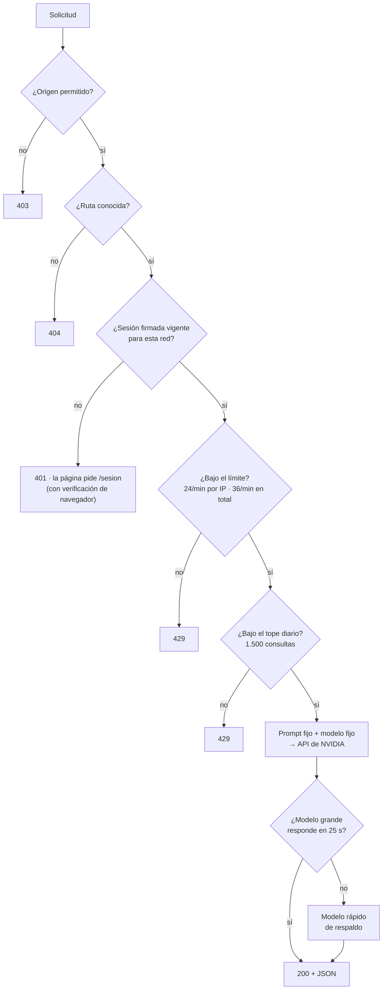

# nv-gateway

**Intermediario mínimo entre páginas estáticas en GitHub Pages y la API de NVIDIA. La página nunca ve la clave; el servidor solo hace cinco tareas fijas.**


**Español** · [English](README.en.md)



## Por qué existe

GitHub Pages solo sirve archivos estáticos. Para que una página llame a un modelo de NVIDIA hace falta una clave, y una clave en el JavaScript de una página pública queda expuesta. Este Worker la guarda como **secreto de Cloudflare** y expone solo lo que las páginas necesitan.

Cada ruta arma su propio prompt y elige su modelo en el servidor; el navegador solo envía la foto o la pregunta. Aun así, una ruta que recibe texto libre puede ser empujada a responder otra cosa, así que las defensas no descansan en el prompt: descansan en quién puede llamar y cuánto.

## Rutas

| Ruta | Usada por | Modelo | Entrada → salida |
|---|---|---|---|
| `POST /inspect` | [Inspector de terreno](https://github.com/JSNN15/inspector) | Nemotron Super VL | foto + tipo → hallazgos en JSON con caja |
| `POST /gauge` | [Lector de instrumentos](https://github.com/JSNN15/lector) | Nemotron Super VL | foto → números de la escala con posición |
| `POST /epp` | [Vigía EPP](https://github.com/JSNN15/vigia) | Nemotron Super VL | foto + sector → EPP de cada persona, riesgo y acción |
| `POST /turno` | [Planta virtual](https://github.com/JSNN15/planta-virtual) | Nemotron Super (respaldo: Lightning 30B) | estado de la planta + pregunta → respuesta con tags |
| `POST /embed` | [Consulta RIC](https://github.com/JSNN15/normativa), [Supervisor](https://github.com/JSNN15/supervisor) | Nemotron Embed 1B | texto → vector (256, 512 o 1024) |
| `POST /ric` | [Consulta RIC](https://github.com/JSNN15/normativa) | Nemotron Super (respaldo: Lightning 30B) | pregunta + 6 extractos → respuesta con citas |
| `POST /supervisa` | [Supervisor normativo](https://github.com/JSNN15/supervisor) | Nemotron Super VL | foto + tipo de inspección → hallazgos con caja y frase de búsqueda |
| `POST /cita` | [Supervisor normativo](https://github.com/JSNN15/supervisor) | Nemotron Super (respaldo: Lightning 30B) | hallazgos + extractos recuperados → artículo elegido, exigencia y acción |
| `POST /identifica` | [Supervisor normativo](https://github.com/JSNN15/supervisor) | Nemotron Super VL (razonamiento si hay duda) | foto → equipo, evidencia, alternativas y zona clave |
| `POST /confirma` | Supervisor normativo | Nemotron Super VL | acercamiento + rasgos del equipo → cuáles se ven |
| `POST /revisa` | Supervisor normativo | Nemotron Super VL | foto + acercamiento + lista → cumple, no cumple o no se ve por punto |
| `POST /verifica` | Supervisor normativo | Nemotron Super VL | acercamiento de un punto → estado, sin ver la respuesta anterior |
| `POST /critica` | Supervisor normativo | Nemotron Super VL | pares hallazgo–artículo → si el artículo lo exige de verdad |
| `POST /reformula` | [Consulta eléctrica](https://github.com/JSNN15/consulta-electrica) | Nemotron Super | conversación + pregunta → consulta de búsqueda autónoma |
| `POST /responde` | Consulta eléctrica | Nemotron Super | pregunta + 8 fragmentos → puntos con fragmento y cita textual |

## Defensas



- **Origen:** solo `https://jsnn15.github.io` (y `localhost` para desarrollo). Sirve contra otros sitios web; un script puede falsificar la cabecera, por eso no es la única defensa.
- **Sesión firmada:** `/sesion` entrega un pase de 30 minutos, firmado con HMAC y válido solo en la red que lo pidió (operador y país; la IP sola cambia entre consultas en redes de empresa y celulares). Sin pase, las demás rutas responden 401. Si el Worker tiene el secreto `TURNSTILE_SECRET`, antes de entregar el pase exige una verificación de [Cloudflare Turnstile](https://developers.cloudflare.com/turnstile/): hace falta un navegador real, no basta con falsificar el origen. Las páginas lo resuelven solas con [`nv.js`](https://github.com/JSNN15/jsnn15.github.io/blob/main/nv.js).
- **Límites en Cloudflare:** 24 consultas por minuto por IP y por sesión, y 36 por minuto en total (`RL_IP` y `RL_TODO`), compartidos entre instancias. El límite anterior vivía en la memoria de cada instancia: 36 consultas en paralelo pasaban todas.
- **Tope diario:** 1.500 consultas en vivo, contadas en D1 (`DB`). Se guarda la fecha y el total; ninguna IP.
- **Fragmentos por número:** `/ric` recibe números de fragmento y el servidor pone el texto desde el índice oficial de pliegos. Antes recibía el texto, y con texto inventado servía como modelo de uso general.
- **Entradas acotadas:** la imagen debe ser un dataURL JPEG, PNG o WebP de hasta 1,6 MB; los textos se recortan antes de llegar al modelo.
- **Errores sin detalle interno:** si NVIDIA falla, la página recibe un aviso corto, no el cuerpo de la respuesta.
- **Salida robusta y respaldo:** JSON con esquema estricto y un reintento; las respuestas de texto usan el modelo grande y, si tarda más de 25 s, el rápido.

**Lo que sigue abierto.** `/turno`, `/responde`, `/cita` y `/critica` reciben texto que arma la página; quedan acotados por largo, por el esquema de salida y por los límites de arriba. Sin el secreto de Turnstile, cualquier cliente que envíe el origen correcto puede pedir un pase. La clave gratuita de NVIDIA es para evaluación: un producto con clientes va con un proveedor de pago y una clave por cliente.

## Desplegar

```bash
npx wrangler deploy                      # sube worker.js (wrangler.toml)
npx wrangler secret put NVIDIA_API_KEY   # pega la clave; nunca va en el repositorio
npx wrangler d1 create nv-portafolio-uso # tope diario; copia el id a wrangler.toml
npx wrangler secret put TURNSTILE_SECRET # opcional: activa la verificación de navegador
```

Los límites por minuto (`RL_IP`, `RL_TODO`) están declarados en `wrangler.toml`. La clave pública del widget de Turnstile va en `SITEKEY`, al comienzo de `worker.js`; el widget se crea en el panel de Cloudflare con el dominio de las páginas.

Probar en local, con las páginas en `localhost:8770`:

```bash
NVIDIA_API_KEY=nvapi-... node dev.mjs    # escucha en :8787
```

## Archivos

| Archivo | Qué es |
|---|---|
| `worker.js` | El Worker completo: rutas, prompts, defensas y respaldo. |
| `dev.mjs` | Servidor local que envuelve `worker.fetch` para desarrollo. |
| `wrangler.toml` | Configuración de despliegue (sin la clave). |

---

<sub>Proyecto personal de **Julián Neira Nova**, ingeniero eléctrico con 10 años en faena · Servicio y Soluciones Tecnológicas DelaCruz SpA. Nada de lo publicado proviene de clientes ni de empleadores.
[Portafolio](https://jsnn15.github.io/) · [LinkedIn](https://www.linkedin.com/in/julian-neira-nova/) · [Todas las máquinas](https://github.com/JSNN15)</sub>
