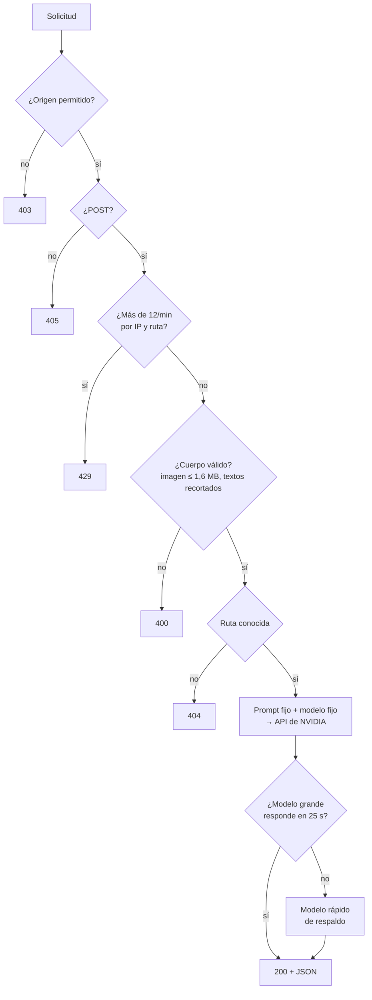

# nv-gateway

**Intermediario mínimo entre páginas estáticas en GitHub Pages y la API de NVIDIA. La página nunca ve la clave; el servidor solo hace cinco tareas fijas.**


**Español** · [English](README.en.md)


## Por qué existe

GitHub Pages solo sirve archivos estáticos. Para que una página llame a un modelo de NVIDIA hace falta una clave, y una clave en el JavaScript de una página pública queda expuesta. Este Worker la guarda como **secreto de Cloudflare** y expone solo lo que las páginas necesitan.

**No es un proxy abierto.** Cada ruta arma su propio prompt y elige su modelo en el servidor; el navegador solo envía la foto o la pregunta.

## Rutas

| Ruta | Usada por | Modelo | Entrada → salida |
|---|---|---|---|
| `POST /inspect` | [Inspector de terreno](https://github.com/JSNN15/inspector) | Nemotron Super VL | foto + tipo → hallazgos en JSON con caja |
| `POST /gauge` | [Lector de instrumentos](https://github.com/JSNN15/lector) | Nemotron Super VL | foto → números de la escala con posición |
| `POST /epp` | [Vigía EPP](https://github.com/JSNN15/vigia) | Nemotron Super VL | foto + sector → EPP de cada persona, riesgo y acción |
| `POST /turno` | [Planta virtual](https://github.com/JSNN15/planta-virtual) | Nemotron Super (respaldo: Lightning 30B) | estado de la planta + pregunta → respuesta con tags |
| `POST /embed` | [Consulta RIC](https://github.com/JSNN15/normativa), [Supervisor](https://github.com/JSNN15/supervisor) | Nemotron Embed 1B | texto → vector (256, 512 o 1024) |
| `POST /ric` | [Consulta RIC](https://github.com/JSNN15/normativa) | Nemotron Super (respaldo: Lightning 30B) | pregunta + 6 extractos → respuesta con citas |
| `POST /supervisa` | [Supervisor normativo](https://github.com/JSNN15/supervisor) | Nemotron Super VL | foto + tipo de inspección → hallazgos con caja y frase de búsqueda |
| `POST /cita` | [Supervisor normativo](https://github.com/JSNN15/supervisor) | Nemotron Super (respaldo: Lightning 30B) | hallazgos + extractos recuperados → artículo elegido, exigencia y acción |

## Defensas



- **Origen:** solo `https://jsnn15.github.io` (y `localhost` para desarrollo). Desde otro sitio, el navegador recibe 403.
- **Límite:** 12 consultas por minuto por IP y ruta (30 para `/embed`), además del límite propio de la API de NVIDIA.
- **Entradas acotadas:** la imagen debe ser un dataURL JPEG, PNG o WebP de hasta 1,6 MB; los textos se recortan antes de llegar al modelo.
- **Salida robusta:** si un modelo de visión devuelve JSON con comas sobrantes, se repara; si igual falla, se reintenta una vez.
- **Respaldo:** las respuestas de texto usan el modelo grande, que se apega mejor a los datos; si falla o tarda más de 25 s, responde el modelo rápido.

El límite por IP vive en memoria de cada instancia: frena abusos casuales, no un ataque distribuido. Para eso se usaría Cloudflare Rate Limiting o KV.

## Desplegar

```bash
npx wrangler deploy                      # sube worker.js (wrangler.toml)
npx wrangler secret put NVIDIA_API_KEY   # pega la clave; nunca va en el repositorio
```

Probar en local, con las páginas en `localhost:8770`:

```bash
NVIDIA_API_KEY=nvapi-... node dev.mjs    # escucha en :8787
```

## Archivos

| Archivo | Qué es |
|---|---|
| `worker.js` | El Worker completo: rutas, prompts, defensas y respaldo. |
| `dev.mjs` | Servidor local que envuelve `worker.fetch` para desarrollo. |
| `wrangler.toml` | Configuración de despliegue (sin la clave). |

---

<sub>Proyecto personal de **Julián Neira Nova**, ingeniero eléctrico con 10 años en faena · Servicio y Soluciones Tecnológicas DelaCruz SpA. Nada de lo publicado proviene de clientes ni de empleadores.
[Portafolio](https://jsnn15.github.io/) · [LinkedIn](https://www.linkedin.com/in/julian-neira-nova/) · [Todas las máquinas](https://github.com/JSNN15)</sub>
